# Publishing Avenues for AI-Assisted and Co-Written Books

**Date:** 2026-11-10  
**Context:** WriterCraft & Fleet Publishing Standards  
**Case Study:** The Rapid-Release Trap ("The Coral Hart Phenomenon" as an *Abschreckendes Beispiel*)

---

## 1. The Core Publishing Avenues (Landscape 2026)

Publishing an AI-assisted or human-sovereign book requires matching the format and thesis to the correct delivery funnel. Different platforms have radically divergent tolerances, economics, and disclosure policies regarding AI.

```mermaid
flowchart TD
    MS["Manuscript Draft<br/>(Markdown / BookKit / Typst)"] --> Choice{"Publishing Strategy"}
    
    Choice -->|Digital Exclusivity & Churn| KDP["Amazon KDP Select / Kindle Unlimited<br/>• Paid per KENP page read ($0.0042/pg)<br/>• Mandatory AI disclosure<br/>• Rapid-release algorithmic dependency"]
    
    Choice -->|Wide Distribution & Print| WIDE["Wide Aggregators (IngramSpark / D2D)<br/>• Barnes & Noble, Apple Books, Kobo, Libraries<br/>• Strict print-on-demand quality control<br/>• Human ISBN registration"]
    
    Choice -->|Serialized & Community| SER["Subscription Serial Platforms<br/>• Ream (Romance/Fantasy Patreon)<br/>• Royal Road (LitRPG/Progression Fantasy)<br/>• Substack / Ghost (Non-fiction monographs)"]
    
    Choice -->|Technical & Academic| ACAD["Continuous & Academic Preprints<br/>• Leanpub (In-progress agile monographs)<br/>• arXiv / bioRxiv / Zenodo (DOI & Open Access)<br/>• University Presses (MIT Press, Cambridge Core)"]
```



---

### Avenue A: Amazon KDP (Kindle Direct Publishing) & KDP Select
- **Market Dominance:** Controls ~80% of English-language digital self-publishing.
- **The Engine:**
  - Standard eBook sale: 70% royalty between \$2.99 and \$9.99 (minus delivery fees).
  - **KDP Select (Kindle Unlimited)**: Requires 90-day digital exclusivity (cannot sell the ebook anywhere else, not even on your own blog). Readers borrow for free; authors are paid from the monthly KDP Select Global Fund per page read (KENP — Kindle Edition Normalized Pages, currently ~\$0.0040 to \$0.0045/page).
- **AI Policies & Enforcement:**
  - **Mandatory Disclosure**: Amazon requires authors to disclose whether text, images, or translations were *AI-generated* (models created content from scratch) vs. *AI-assisted* (human created, AI refined).
  - **Upload Caps**: In response to massive AI catalog flooding, Amazon instituted daily title upload limits (3 titles per author account per day).
  - **Account Termination Risk**: High. Amazon's bot-detection algorithms aggressively terminate accounts suspected of "disrupting customer reading experience" (low-quality automated page flips, translation scraping, or duplicate text across pen names).

---

### Avenue B: "Wide" Aggregators & Physical Print Distribution
- **Platforms:** **IngramSpark**, **Draft2Digital (D2D)**, **Smashwords**, **Kobo Writing Life**, **Apple Books**, **Google Play Books**.
- **The Advantage:** Non-exclusive. You own your customer relationships and can distribute to public libraries, university catalogs, independent bookstores, and OverDrive/Libby.
- **IngramSpark Print-on-Demand (POD):**
  - The industry standard for getting paperback and hardcover books into Ingram's global catalog (which brick-and-mortar bookstores and libraries order from).
  - **Quality Gates**: Very strict PDF preflight standards (bleed, spine width, CMYK color profiles, embedded fonts). High-quality cover design is mandatory; automated generic AI covers are rejected or ignored by bookstore buyers.

---

### Avenue C: Direct-to-Consumer & Serialized Subscription
- **Ream (reamstories.com):**
  - Built specifically by and for indie fiction authors as an alternative to Patreon and Amazon.
  - Readers subscribe monthly (\$5, \$10, \$25/mo) for early chapter access, bonus side-stories, and author community.
  - Excellent for character-driven fiction with high reader loyalty; zero platform exclusivity penalties.
- **Royal Road / Webnovel:**
  - The dominant launchpad for **LitRPG, Progression Fantasy, and Isekai**.
  - Authors post 3–5 chapters per week for free to climb the "Rising Stars" rankings, funnel readers to Patreon for advance chapters, and later bundle 80,000-word arcs into Amazon Kindle Unlimited books.
  - **Community Rule**: Highly vigilant readers. If a writer dumps raw unedited AI prose, the community downvotes and flags the story within hours. Transparent human authoring is heavily rewarded.
- **Substack & Ghost:**
  - The premier venue for non-fiction, investigative essays, and epistemic philosophy (such as the *On...* book series).
  - Direct email subscriber monetization. You keep 90%+ of subscription revenue and 100% of reader email addresses.

---

### Avenue D: Continuous & Academic Publishing
- **Leanpub:**
  - *"Publish Early, Update Often"*. Built for software engineers, mathematicians, and technical writers.
  - Authors publish at Chapter 3 as an "In-Progress Book" in Markdown/Typst; readers buy with sliding price scales (\$9.99 to \$49.99) and receive free updates as subsequent chapters are finished.
- **arXiv / bioRxiv / Zenodo:**
  - Essential for preprints, formal proofs, and epistemic monographs.
  - Assigns durable DOIs. Un-gated, universally accessible, and permanently archived.
  - **Attribution Rule**: AI models *cannot* be listed as an author (ICMJE guidelines require authors to be legal entities capable of taking accountability for claims). AI tools must be cited in the *Methodology / Acknowledgments* section.

---

## 2. Case Study: The "Coral Hart" Phenomenon as an *Abschreckendes Beispiel*

In late 2025 and early 2026, international headlines (*The New York Times*, *Africanews*, *eNCA*) highlighted **Coral Hart** (pseudonym), a Cape Town-based former publishing ghostwriter who used automated multi-LLM pipelines (Claude for outlines, ChatGPT for banter, Grok for spicy scenes) to publish **over 370 books across 21 pen names in a single year**, reportedly grossing over **\$1,000,000**.

While celebrated in some tech circles as an efficiency breakthrough, in serious literary and commercial publishing this model is viewed as a **cautionary tale (*abschreckendes Beispiel*)**.

```
               THE RAPID-RELEASE CHURN TRAP
               
  [High LLM Output] ──> [300+ Books Published]
         │                          │
         ▼                          ▼
  [30-Day Cliff]     ──> [Revenue Tied to Endless Uploads]
         │                          │
         ▼                          ▼
  [Toxic Backlash]   ──> [Zero Backlist Longevity (Decays like Milk)]
```

### Why the 300-Book Strategy is an Anti-Pattern:

#### 1. The Algorithmic Hamster Wheel (The 30-Day Cliff)
Amazon’s recommendation engine gives new releases an algorithmic visibility boost for roughly 30 days. To sustain that income without organic word-of-mouth, an author **must release a new title every 1–2 days**. 
- The author does not own an enduring catalog; they own an **accelerating treadmill**. 
- The moment generation stops, visibility plunges and revenues evaporate.

#### 2. Extreme Platform Fragility
Amazon KDP periodically purges publisher accounts for catalog flooding, manipulated page reads, or deceptive publishing practices. Operating 21 pen names with hundreds of algorithmically generated novellas means a single automated fraud-detection sweep can wipe out 100% of your business overnight with zero right of appeal.

#### 3. Brand Toxicity and Reader Alienation
Hart received intense global backlash, one-star review bombing, and hate mail from romance readers who felt deceived by formulaic filler. Once an author or pen name is identified as an "AI churn mill," human communities actively blacklist the author. High-value loyal readers (who buy hardcovers, attend signings, and purchase merchandise) disappear; you are left competing only for transient, zero-cost Kindle Unlimited clicks.

#### 4. Zero Durable Catalog Equity (Milk vs. Wine)
- **A sovereign backlist compounds like fine wine.** Books by Ursula K. Le Guin, J.R.R. Tolkien, Neal Stephenson, or Nassim Nicholas Taleb earn royalties 10, 20, and 50 years after publication because every page carries enduring human insight.
- **An AI churn catalog decays like milk.** A 25,000-word billionaire novella generated to exploit a 2025 algorithm will be completely forgotten in six months, replaced by millions of cheaper, fresher synthetic titles generated by subsequent model weights.

#### 5. Spiritual & Creative Burnout
The creator ceases being a writer, thinker, or artist. They become an unpaid, high-stress quality assurance clerk for a multi-agent text pipeline—spending 14 hours a day proofreading generic banter, fixing prompt refusals, and formatting EPUBs.

---

## 3. The WriterCraft Alternative: Sovereign Craftsmanship with Agent Power

WriterCraft rejects the rapid-release churn mill. Instead, it implements **Sovereign Craftsmanship**:

| Metric | The Churn Factory (Coral Hart Model) | Sovereign Craftsmanship (WriterCraft / Fleet) |
|---|---|---|
| **Volume Target** | 300+ titles / year | 1–3 definitive monographs / year |
| **Author Role** | Prompt operator & formatting QA clerk | Sovereign editor, taste judge, epistemic architect |
| **Model Usage** | Generating bulk prose filler | Research assistant, tension analyzer, linter, dialectic antagonist |
| **Prose Quality** | High AI-tell density (loadbearing, delve, tapestry) | Zero-slop enforcement via deterministic `StyleLinter` |
| **Factuality** | Hallucinated details smoothed over | Rigid `[construction]` claim ledgers & dated empirical anchors |
| **Asset Longevity** | Decays in 30 days | Durable backlist compounding over decades |
| **Syndication** | Automated spamming across networks | Local staging in `outbox/` — **never sent unasked** |

---

## 4. Practical Checklist for Publishing AI-Co-Written Books

When preparing a manuscript created with WriterCraft for publication:

1. **Deterministic Style Linting:**
   ```powershell
   writercraft-cli lint chapters/01-the-breach.md
   ```
   Ensure Rhetorical Grade is **A+** or **B**. Purge all instances of *loadbearing*, *tapestry*, *delve*, and reflexive triads before building the production package.
2. **Resolve All Claim Flags:**
   ```powershell
   writercraft-cli audit chapters/01-the-breach.md
   ```
   Check that open `[construction: ...]` tags are either verified with dated facts or cited with clean numerical footnotes `[^1]`.
3. **Select the Distribution Model:**
   - **For Long-Form Non-Fiction / Deep Tech:** Publish serialized chapters to Substack/Ghost; publish in-progress drafts to Leanpub; archive formal versions on arXiv/Zenodo.
   - **For Fiction (Romance/Sci-Fi/Thriller):** Build a direct subscriber community on Ream or Royal Road; release polished, high-density volumes to Amazon KDP and IngramSpark.
4. **Honest Platform Disclosure:**
   In Amazon KDP metadata, select *"AI-assisted: Yes"* and declare that AI was utilized for structural outlining and editing under human authorial supervision. This protects your KDP account from automated purge sweeps.
